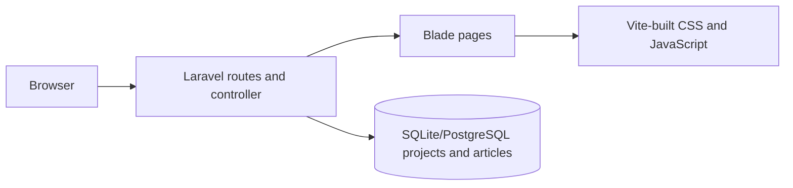

# portfolio-laravel

Server-rendered portfolio for Jackson Severino da Rocha, positioned around backend engineering with Python, FastAPI, Java, Spring Boot, REST APIs, PostgreSQL, and Docker.

## Dynamic projects

Projects are stored in `projects` and `project_translations`. Public routes query only
non-archived translations with `editorial_status=published`; missing and draft
translations are never used as a locale fallback. Import the verified catalog with:

```sh
php artisan portfolio:import-projects
php artisan portfolio:import-projects --dry-run
```

The importer creates missing records and translations only, preserving later editorial
changes. Review its inconsistency count before publishing.

### Administration

Set `PORTFOLIO_ADMIN_EMAILS` to the owner-approved address list, migrate, and provision
the initial account interactively. No password is stored in the repository:

```sh
php artisan migrate --force
php artisan portfolio:admin owner@example.com
```

The panel is available at `/admin/login`. There is no public registration. Login is
session-based, rate-limited, CSRF-protected, regenerated after authentication, and
restricted by `ProjectPolicy`. Mutations are recorded in `admin_audits`.

Back up the database and `storage/app/private` before releases. To roll back, verify
the backup and run `php artisan migrate:rollback --step=1`; this removes the project
tables and is intentionally destructive.

### Writing articles

Writing articles are stored in `articles` and `article_translations`; the database is
the only public source after import. The importer preserves the original Markdown and
does not overwrite translations created or edited in the panel:

```sh
php artisan portfolio:import-articles --dry-run
php artisan portfolio:import-articles
```

Each locale has its own editorial state. Public Writing routes require a published
translation in the requested locale, while administrative previews use `noindex` and
`Cache-Control: no-store, private`. Markdown is rendered with HTML stripping and
unsafe-link rejection. There is no scheduler or application cache for Writing yet;
manual publication is the operational workflow and changes are immediately visible.
Article rollback follows the same database backup and migration rollback procedure.

> **Screenshot pending:** add an approved screenshot after visual review at common mobile and desktop widths.

## Architecture

Laravel 13 serves Blade views from named routes. Dynamic projects and Writing articles
use Eloquent; the versioned Markdown files are migration input/backup, not a runtime
source. The sitemap, robots rules, and Laravel `/up` health endpoint are served by the application.



## Stack and requirements

- PHP 8.4+ (Laravel 13 currently requires PHP 8.3+), Composer 2
- Node.js 22+ and npm
- SQLite with `pdo_sqlite` for local setup
- Docker Engine and Compose plugin for containers
- Laravel 13, Blade, Tailwind CSS 4, Vite, Pest 5 / PHPUnit 13, Pint, PHPStan / Larastan

## Local setup

```sh
composer install
cp .env.example .env # PowerShell: Copy-Item .env.example .env
php artisan key:generate
npm ci
npm run build
php artisan serve
```

Set `APP_URL` to the local origin. SQLite is configured by default; the database file is `database/database.sqlite`. You can also run `composer run setup` for key creation, migrations, npm installation, and the frontend build after dependencies are installed. `composer run dev` starts the local PHP server and Vite. `PORTFOLIO_CONTACT_EMAIL` and résumé settings are optional; email remains empty until an approved address is supplied, and the résumé is disabled until an approved PDF and explicit approval flag are configured. See [professional contact and résumé setup](docs/development/contact-and-resume.md). Never put secrets in content or commit `.env`.

For hot reload, run `npm run dev` in a second terminal. Useful checks: `composer test`, `composer lint`, `composer analyse`, `php artisan test --coverage --min=80` (with a coverage driver), `npm run build`. See the [validation report](docs/testing/validation-report.md) for the checks executed in this workspace.

## Docker setup

`docker compose up --build` builds a PHP-FPM application image and a separate Nginx image, both running non-root, and serves the site on port 8080. The app filesystem is read-only apart from explicit writable volumes/tmpfs. Set a unique `APP_KEY`; file-backed sessions/cache and logs use the persistent app-storage volume. Session cookies default to `Secure` in production; if testing local HTTP stateful behavior, set `SESSION_SECURE_COOKIE=false` in the local `.env`. The portfolio currently needs no database at runtime. Compose is a local/demo topology; no production host or cloud is selected.

## CI/CD

Pull requests and pushes to `main` run Composer install, Pint, Larastan, Pest with an 80% first-party coverage threshold, npm install, and production build. Security workflows audit Composer and npm dependencies and run CodeQL / dependency review where GitHub supports them. The deploy workflow is deliberately disabled without a selected target and explicit adapter configuration. Tagged releases require a manual workflow dispatch.

## Deployment

Select a hosting target, provision PHP 8.4+ or run the provided container, configure HTTPS, `APP_KEY`, `APP_URL`, persistence, backups, and protected GitHub environment settings. Follow `docs/deployment/production.md`; deployment is not active until a reviewed target adapter is added.

## Security

No contact form or user-submitted content is enabled. Keep dependencies updated, protect secrets, use HTTPS, least privilege, and review the threat model and checklist in `docs/security/`.

## Repository map

`app/Http/Controllers` page and admin controllers · `app/Models` persisted portfolio entities · `config/portfolio.php` curated catalog · `resources/views` Blade · `resources/content/articles` versioned article import source · `tests` Pest · `docs` engineering and operating guidance · `.github/workflows` automation.

The public site is available in Portuguese (Brazil) and English. See the [internationalization guide](docs/development/internationalization.md) for route, content, translation, and SEO conventions; all future user-facing changes must support and test both locales.

## Contributing

Read [CONTRIBUTING.md](CONTRIBUTING.md), run the checks above, and cite evidence for project or contribution claims in content PRs. Do not publish unverified history, metrics, client information, or credentials.

## License

MIT. See [LICENSE](LICENSE). The portfolio application is licensed; names and third-party marks retain their owners' rights.

## Author

Jackson Severino da Rocha · [GitHub](https://github.com/jacksonsr451) · [LinkedIn](https://www.linkedin.com/in/jackson-severino-da-rocha/). The GitHub profile was verified. The owner supplied the LinkedIn URL for this portfolio, but LinkedIn blocked automated access during review (HTTP 999). No professional email or approved résumé PDF was supplied; both remain unpublished until approved and configured.
