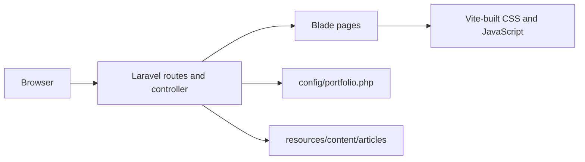

# portfolio-laravel

Server-rendered portfolio for Jackson Severino da Rocha, positioned around backend engineering with Python, FastAPI, Java, Spring Boot, REST APIs, PostgreSQL, and Docker.

> **Screenshot pending:** add an approved screenshot after visual review at common mobile and desktop widths.

## Architecture

Laravel 13 serves Blade views from named routes. Small, curated project metadata lives in `config/portfolio.php`; technical articles are Markdown files with validated front matter in `resources/content/articles/`. No database is required to render public content. The sitemap, robots rules, and Laravel `/up` health endpoint are served by the application.



## Stack and requirements

- PHP 8.4+ (Laravel 13 currently requires PHP 8.3+), Composer 2
- Node.js 22+ and npm
- SQLite with `pdo_sqlite` for local setup
- Docker Engine and Compose plugin for containers
- Laravel 13, Blade, Tailwind CSS 4, Vite, Pest 5 / PHPUnit 13, Pint, PHPStan / Larastan

## Local setup

```sh
composer install
cp .env.example .env # PowerShell: Copy-Item .env.example .env
php artisan key:generate
npm ci
npm run build
php artisan serve
```

Set `APP_URL` to the local origin. SQLite is configured by default; the database file is `database/database.sqlite`. You can also run `composer run setup` for key creation, migrations, npm installation, and the frontend build after dependencies are installed. `composer run dev` starts the local PHP server and Vite. `PORTFOLIO_CONTACT_EMAIL` and `PORTFOLIO_RESUME_PATH` are optional and intentionally empty until approved contact details and an approved PDF are supplied. Never put secrets in content or commit `.env`.

For hot reload, run `npm run dev` in a second terminal. Useful checks: `composer test`, `composer lint`, `composer analyse`, `php artisan test --coverage --min=80` (with a coverage driver), `npm run build`. See the [validation report](docs/testing/validation-report.md) for the checks executed in this workspace.

## Docker setup

`docker compose up --build` builds a production-oriented PHP-FPM image and serves it with Nginx on port 8080. Set a unique `APP_KEY` and configure a persistent SQLite volume before production use. Compose is a local/demo topology; no production host or cloud is selected.

## CI/CD

Pull requests and pushes to `main` run Composer install, Pint, Larastan, Pest with an 80% first-party coverage threshold, npm install, and production build. Security workflows audit Composer and npm dependencies and run CodeQL / dependency review where GitHub supports them. The deploy workflow is deliberately disabled without a selected target and explicit adapter configuration. Tagged releases require a manual workflow dispatch.

## Deployment

Select a hosting target, provision PHP 8.4+ or run the provided container, configure HTTPS, `APP_KEY`, `APP_URL`, persistence, backups, and protected GitHub environment settings. Follow `docs/deployment/production.md`; deployment is not active until a reviewed target adapter is added.

## Security

No contact form or user-submitted content is enabled. Keep dependencies updated, protect secrets, use HTTPS, least privilege, and review the threat model and checklist in `docs/security/`.

## Repository map

`app/Http/Controllers` public page controller · `config/portfolio.php` curated catalog · `resources/views` Blade · `resources/content/articles` Markdown · `tests` Pest · `docs` engineering and operating guidance · `.github/workflows` automation.

## Contributing

Read [CONTRIBUTING.md](CONTRIBUTING.md), run the checks above, and cite evidence for project or contribution claims in content PRs. Do not publish unverified history, metrics, client information, or credentials.

## License

MIT. See [LICENSE](LICENSE). The portfolio application is licensed; names and third-party marks retain their owners' rights.

## Author

Jackson Severino da Rocha. Verified public profile/contact URLs are not available in this project context yet; links will be published after confirmation.
