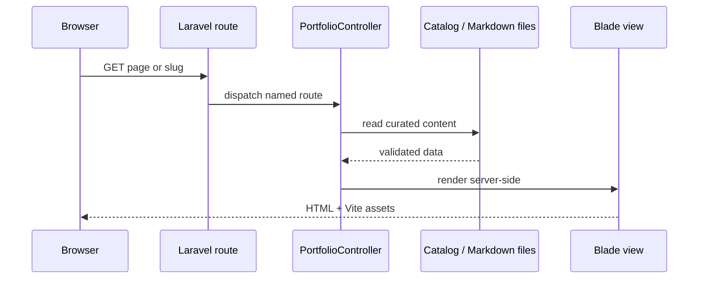
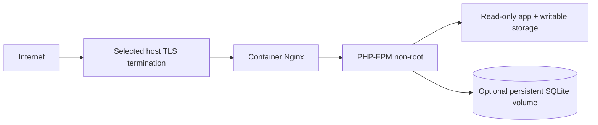

# Diagrams

## Request flow

## Deployment topology (prepared container)

The production host remains unselected; the diagram describes the provided container shape, not an active deployed system.
